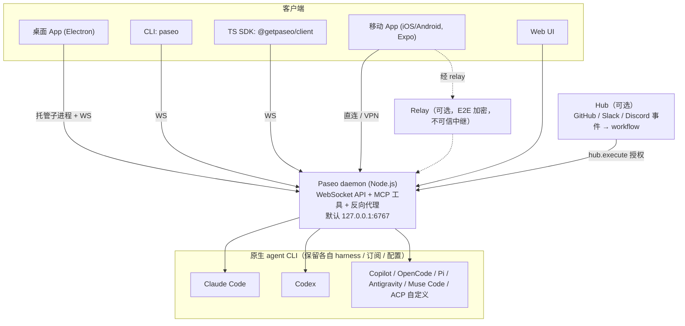
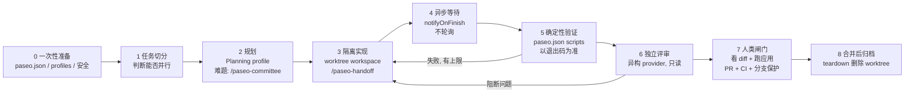

# 60 · Paseo 调研与最佳实践开发流程

> 本文是对新研究对象 **Paseo**（github.com/getpaseo/paseo）的调研产出，回答两个问题：Paseo 是什么；从最佳实践出发，使用它时的开发流程应该怎样设计。
>
> **证据锚定**：Paseo 仓库提交 `b412374f0c520fbc0470d15d2652b47eea3efef8`（2026-10-11），对应版本 `0.11.2`（`CHANGELOG.md`）。仓库只在会话临时目录中 `git clone --depth 1` 后只读阅读，**未做任何修改、提交或推送**（沿用 [`AGENTS.md`](../AGENTS.md) 对研究对象的只读铁则）。下文 `path` 均为 Paseo 仓库内路径。
>
> **标注约定**：「**证据**」= 直接来自 Paseo 仓库文件；「**综合判断**」= 本研究的推断，附置信度（高 ≥80% / 中 50–80% / 低 20–50%）。最佳实践流程（§4）和推荐配置（§5）整体属于综合判断：它由官方文档的推荐用法加上本研究对风险的补强组成，补强部分逐条标出。

## 0. 一句话结论

- **证据**：Paseo 是一个开源、自托管的 **agentic 开发环境 / 多 agent 编排层**。本地 daemon 管理多个原生 coding-agent CLI（Claude Code、Codex、Copilot、OpenCode、Pi、Antigravity、Muse Code），桌面 / 移动 / Web / CLI 客户端连接同一个 daemon；以 **workspace（可选 git worktree 隔离）** 为组织单位，内置 agent 互相派生、互发消息、定时任务和事件触发（Hub）（`README.md`、`public-docs/why.md`、`docs/architecture.md`）。
- **综合判断（中）**：Paseo 提供了**并行和编排的机制**，但**不提供安全隔离，也不提供质量闸门**。worktree 只隔离文件，不隔离权限；"做完了"由谁判定，Paseo 留给你自己设计。所以最佳实践的重点不在"多开 agent"，而在 **任务切分、确定性验证、跨模型独立评审、人类合并闸门、权限收敛** 这五件事。

## 1. Paseo 是什么（证据）

### 1.1 架构



- daemon 负责 spawn / 管理 agent 进程，并通过 WebSocket 实时推送 timeline（`docs/architecture.md:1-40`）。
- 桌面 App 自带并自动管理 daemon；服务器上用 `npm install -g @getpaseo/cli && paseo` 启动；另有 Docker 镜像（`README.md` "Getting Started"）。
- **每个 agent 保留自己的原生 harness**：沿用你的订阅、凭据、配置、skills、MCP server（`public-docs/why.md` "Use your agents and tools"）。Paseo 不管理 provider 凭据（`public-docs/security.md` "Agent authentication"）。

### 1.2 核心概念

| 概念 | 含义 | 证据 |
| --- | --- | --- |
| **Project** | 一个 git 仓库 / GitHub 项目 / 任意目录 | `public-docs/workspaces.md` |
| **Workspace** | "任务发生的地方"：一个工作目录 + 多个 session（agent、终端、浏览器、diff 标签页）。**Paseo 以 workspace 而不是 chat 组织工作** | `public-docs/workspaces.md` |
| **Isolation** | `local`（共用现有目录）或 `worktree`（托管 git worktree + 独立分支） | `public-docs/workspaces.md` "Choose the isolation" |
| **`paseo.json`** | 仓库根配置：worktree `setup`/`teardown`、`scripts`、`service`（自动分配端口 + 反向代理）、自动打开的终端 | `public-docs/worktrees.md` "paseo.json" |
| **Subagent** | 由 agent 通过 MCP 工具或 CLI 派生、可跨 provider 的完整会话；出现在父 agent 的 Subagents track | `public-docs/orchestration-workflows.md` "Where the work appears" |
| **Agent profile** | 一组 provider/model/mode/thinking 设置 + "When to use" 备注，供人一键选用、供编排 agent 据备注选型 | `public-docs/agent-profiles.md` |
| **Orchestration skills** | `/paseo`、`/paseo-handoff`、`/paseo-committee`、`/paseo-advisor` | `public-docs/skills.md`、`skills/*/SKILL.md` |
| **Schedule / Heartbeat** | Schedule：按 cron 每次起一个**新** agent；Heartbeat：按 cron 唤醒**同一个** agent 继续工作 | `public-docs/schedules.md` |
| **Hub** | daemon 之上的一层：GitHub/Slack/Discord 事件 → trigger → 多步 workflow → 在指定 daemon 上起 agent；配置以 `.paseo/` 目录放在仓库里 | `public-docs/hub/index.md`、`public-docs/hub/concepts.md` |
| **Plugins** | 跑在 daemon 上，可加 UI、生命周期钩子、新 provider；`paseo plugin add owner/slug` | `README.md` "Plugins" |

### 1.3 编排能力（证据）

- **MCP 工具**（默认关闭，需在 Settings → host → Agents 开启 "Enable Paseo tools"）：`create_workspace`、`create_agent`、`send_agent_prompt`、`list_agents`、`archive_agent`、`list_profiles`、`list_providers`、`create_schedule`、`create_heartbeat`、workspace script 启停等（`public-docs/orchestration.md` "Get started"、`skills/paseo/SKILL.md`）。
- **CLI**（agent 有 shell 即可用，无需开启工具注入）：`paseo run [--provider p/m] [--worktree|--new-workspace worktree] [--no-wait]`、`paseo ls`、`paseo attach`、`paseo send`、`paseo wait`、`paseo logs`、`paseo permit allow/deny`、`paseo agent mode <id> plan|bypass`、`--host` 远程 daemon（`public-docs/cli.md`）。
- **异步优先**：`create_agent` 在 agent 范围内默认 `notifyOnFinish: true`，官方明确要求"不要轮询"，并说明 10–30 分钟以上的运行很常见（`skills/paseo/SKILL.md` "Waiting"）。

### 1.4 安全模型（证据，开发流程的关键约束）

- **连接层**：默认只监听 `127.0.0.1:6767`；relay 默认关闭，开启后为 E2E 加密（Curve25519 + XSalsa20-Poly1305），中继被设计为不可信；配对二维码等同于密码；绑定 `0.0.0.0` 必须设密码；Host 白名单防 DNS rebinding（`public-docs/security.md`）。
- **权限层**：daemon 权限是语义化的加法授权（`workspace.write`、`automation.manage`、`hub.execute` 等），**目前是 daemon 级，不能限定到某个 workspace**；并明确写道：agent 和终端都能执行代码，"单独的写权限会声称一个 daemon 无法强制执行的隔离边界"（`docs/permissions.md` "Permissions"、"Resources"）。
- **Hub**：Hub 不沙箱 provider 进程，也不让外部文本变安全；外部触发器必须配置非空的 `from_users` 白名单；能推送 `.paseo` 配置的人就能决定连哪些 daemon、给哪些能力（`public-docs/hub/security.md`、`public-docs/hub/concepts.md` "Security boundaries"）。
- **Provider 模式**：Antigravity 只有 Full access，Paseo 以 `--dangerously-skip-permissions` 启动 `agy`（`public-docs/supported-providers.md:29-30`）；官方 skill 的 CLI 示例使用 `--mode full-access`（`skills/paseo/SKILL.md` "CLI semantics"）。
- **工具目录裁剪不是安全边界**：可以按 provider 禁用部分 Paseo MCP 工具，但文档明确说"对能通过 shell 访问宿主的 agent 而言，这不是安全边界"（`public-docs/mcp.md:65-73`）。
- **Hub 运行无人值守审批**：Hub 每次运行都预先批准它自己的工具，因为"没人在键盘前审批"；目前只提供 Claude、Codex、OpenCode 作为 provider（`public-docs/hub/triggers/index.md:39`）。
- **Plugins**："拥有 daemon 所在机器以及已连接客户端的访问权，只安装你信任的代码"（`README.md` "Plugins"）。

## 2. 官方推荐的工作模式（证据）

官方文档给出六种可直接用自然语言触发的编排模式（`public-docs/orchestration-workflows.md`）：

1. **换模型执行**：主会话做规划，读取 profile 后选一个做实现，建 worktree workspace，派 subagent 实现并跑聚焦测试。
2. **研究扇出**：多个 subagent 在**同一** workspace 只读调查不同方面，主 agent 汇总。
3. **无冲突并行修改**：每个独立改动用**独立 worktree** workspace。
4. **先实现后评审**：实现 worker 完成后，在同一 workspace 起一个**新会话**的独立 reviewer；想要另一个模型的判断就用不同 provider 的 profile。
5. **agent 间按 ID 发消息**（`send_agent_prompt`）。
6. **Heartbeat 续跑**：例如"每 10 分钟小步推进迁移，每步跑聚焦检查，完成后删除 heartbeat，2 小时后过期"。

另有桌面端手动并行流程（`public-docs/parallel-development.md`）：每个任务新建 worktree workspace（起点 `origin/main`）→ 并发运行 → 在 Changes 看 diff → 在终端 / 内置浏览器测试 → 选择合并 → 归档 workspace，触发 teardown 并删除 worktree。

## 3. 关键反论与风险（综合判断，先于流程陈述）

| # | 风险 / 反论 | 依据 | 置信度 |
| --- | --- | --- | --- |
| R1 | **worktree ≠ 沙箱**。所有 agent 以你的 OS 用户和凭据运行，daemon 权限不分 workspace；一个 full-access agent 可以读写 worktree 之外的任何东西 | `docs/permissions.md`、`public-docs/security.md` "Agent authentication"、`public-docs/hub/security.md` | 高 |
| R2 | **官方示例里的 implement→verify 循环没有迭代上限**，并且用 LLM 判断"测试是否都通过"，而不是直接看测试命令的退出码 | `public-docs/cli.md:462-475`（`while true` + `--output-schema` 判定） | 高（示例原文如此）；是否误导用户：中 |
| R3 | **并行的瓶颈在人类评审带宽和合并冲突，不在 agent 数量**。worktree 只是把冲突推迟到合并时；N 个并行分支 ≈ N 份需要人看的 diff | 推断；官方也只把"无冲突"限定在"独立改动"（`orchestration-workflows.md`） | 中 |
| R4 | **成本 / 配额不可见到可控**：每个 subagent 都消耗你的订阅配额；0.11 才加入 Usage 面板 | `CHANGELOG.md` 0.11.0 "Usage" | 中 |
| R5 | **项目成熟度**：版本 0.x，0.11.0 改变了 `paseo plugin add` 的语义（破坏性变更）；README 自述"built by one person" | `CHANGELOG.md` 0.11.0 "Before upgrading"、`README.md` "Sponsors" | 高（事实）；对企业采用的影响：中 |
| R6 | **供应链面**：plugin 和 skill 都在 daemon 权限下运行；Hub 配置分支等同于授权配置 | `README.md` "Plugins"、`public-docs/security.md` "Recommendations" | 高 |
| R7 | **第三方资料已漂移**：检索到的目录站称 AGPL-3.0、提到 `/paseo-loop` skill；锚定提交的 `LICENSE` 为 Apache-2.0，`skills/` 下也没有 `paseo-loop`。以仓库为准 | `LICENSE:1-8`、`skills/` 目录列表 | 高 |

## 4. 最佳实践开发流程（综合判断）

总体形态：**一个任务 = 一个 workspace；规划 → 隔离实现 → 确定性验证 → 跨模型独立评审 → 人类合并闸门 → 归档**。人负责目标、边界和验收，agent 负责可验证的执行单元（与 [docs/50](50-enterprise-adoption-zh.md) 的核心理念一致）。



### 第 0 步：一次性准备（每个仓库 / 每台机器做一次）

1. **在仓库根提交 `paseo.json`**（官方能力，`public-docs/worktrees.md`）：
   - `worktree.setup`：安装依赖，并把被 git 忽略的 `.env` 等文件从 `$PASEO_SOURCE_CHECKOUT_PATH` 复制过来（新 worktree 没有依赖，也没有被忽略的文件）。
   - `scripts`：至少定义 `test`、`lint`、`typecheck`。这是第 5 步确定性验证的统一入口，agent 和人都通过 `paseo script start` 或对应 MCP 工具调用同一套命令。
   - `service`：开发服务器绑定 `$PASEO_PORT`，前端通过 `$PASEO_SERVICE_<NAME>_URL` 找后端，避免多个 worktree 端口冲突。
   - 注意：Paseo 从**你选的 base 分支的已提交版本**读取 `paseo.json`，未提交的修改不生效。
   - 参考样例：Paseo 自己仓库的 `paseo.json`，setup 为 `npm ci` 加构建，scripts 定义 daemon/app 等 service 和 `typecheck`。
2. **建立 agent profiles 并写好 "When to use"**（`public-docs/agent-profiles.md`），建议至少四个：
   - `Planning`：高推理档；用于架构、根因分析、方案比较。
   - `Implementation`：用于按明确验收标准实现与跑聚焦测试。
   - `Review`：**选与 Implementation 不同的 provider 家族**；只用于对 diff 做正确性、缺失测试、多余复杂度评审，并配置为只读 / plan 模式（补强，见下）。
   - `UI work`：组件、布局、样式。
   - 理由：官方 skill 强制编排 agent 先读 `list_profiles` 的 notes 再派工（`skills/paseo-handoff/SKILL.md` "Prerequisites"），profile 备注写得越清楚，自动选型越可靠。
3. **安装 skills、开启 Paseo tools**（默认关闭）：`npx skills add getpaseo/paseo`，或在 Settings → Orchestration skills 中安装（`public-docs/skills.md`）。
4. **安全基线**（官方建议 + 本研究补强）：
   - 远程访问优先用 relay 或 Tailscale；绑定网络地址必须设密码；**永远不要无密码绑定 `0.0.0.0`**（`public-docs/security.md` "Recommendations"）。
   - **补强（R1）**：涉及生产凭据或敏感仓库时，把 daemon 放进专用 OS 用户、容器或 VM（官方 Hub 安全文档也建议这样做），Docker 挂载只覆盖目标仓库；Review、研究类 profile 使用 provider 原生只读能力（如 Codex `sandbox_mode: read-only`，见 `public-docs/hub/security.md` "Provider-native controls"）。
   - **补强（R6）**：plugin 只从经过评审的来源安装，并在团队内维护允许清单。

### 第 1 步：任务切分（人主导）

- 判断标准：**两个任务改动的文件集合是否基本不相交**。相交就串行，不相交才并行。worktree 能避免运行时互相踩文件，但避免不了合并冲突（R3）。
- 并行度按**你能认真评审的 diff 数**来定，而不是按机器能开多少 agent（R3，综合判断，中）。
- 每个任务先写下**验收标准**（可执行的命令或可观察的行为），后续所有 briefing 都引用它。

### 第 2 步：规划

- 常规任务：在主会话用 `Planning` profile 产出方案和验收标准。
- 难题、反复失败、陷入隧道视野时：`/paseo-committee`。两个不同 provider 家族的 agent 各自只读分析，主 agent 在两者之间传递论据直到收敛（`skills/paseo-committee/SKILL.md`）。
- 想要第二意见但不移交工作：`/paseo-advisor`（只读）。
- 研究扇出（官方模式 2）可以放在 `local` workspace，因为只读不改文件。

### 第 3 步：隔离实现

- 有写操作的任务一律使用 **worktree workspace**，基线写 `origin/main` 而不是 `main`。官方说明本地 `main` 可能过时，`origin/main` 指向后台 fetch 的远端引用（`public-docs/worktrees.md` "Create a worktree-backed workspace"）。
  ```bash
  paseo run --new-workspace worktree --worktree-mode branch-off \
    --new-branch feature/auth --base origin/main \
    --provider <Implementation 档 provider/model> "<briefing>"
  ```
- 从一个会话移交到另一个 agent 时使用 `/paseo-handoff`。它规定的 briefing 结构（Task / Context / Relevant files / Current state / What was tried / Decisions / Acceptance criteria / Constraints）就是一份合格的工单模板，并要求**保留任务语义**：只调查的任务要写明 "DO NOT edit files"（`skills/paseo-handoff/SKILL.md`）。
- **权限模式**：实现 agent 优先使用 provider 的默认审批模式，审批请求可在手机上或用 `paseo permit` 处理。只有在第 0 步的容器 / VM 隔离已经到位时，才使用 `full-access` / `bypass`（补强，R1）。

### 第 4 步：异步等待

- 保持 `notifyOnFinish` 默认开启；**不要轮询、不要催促**，长推理模型 15–30 分钟属正常（`skills/paseo/SKILL.md` "Waiting"、`skills/paseo-committee/SKILL.md` "Hard rules"）。
- 长时间的增量任务（如迁移）用 **heartbeat**，并且**必须设置 `expiresIn` 或 `maxRuns`**（官方示例本身就设了 2 小时过期），防止无人看管的循环一直跑（补强，R2/R4）。
- 人可以离开工位，在移动端看进度、批准权限请求、补充指令。

### 第 5 步：确定性验证（补强重点）

- **"完成"由命令的退出码判定，不由 agent 的自述判定**：worker 必须运行 `paseo.json` 中的 `test` / `lint` / `typecheck` 脚本，失败就带着输出回到第 3 步。
- **修复循环必须有上限**（例如 3 轮），超出就升级给人，或转 `/paseo-committee` 做根因分析。官方 CLI 示例的 `while true` + LLM 判定不应照搬（R2）。
- 有 UI 的改动：启动 `service`，用内置浏览器（必要时开启浏览器自动化）按具体步骤验证并截图（`public-docs/parallel-development.md` "Run and test the app"）。

### 第 6 步：跨模型独立评审

- 在**同一** workspace 新建一个 `Review` profile 的 agent，让它在**全新上下文**中评审 diff（官方模式 4）。briefing 末尾加只读后缀："This is analysis only. Do NOT edit, create, or delete any files."（与 committee/advisor skill 的硬规则一致）。
- **使用与实现者不同的 provider 家族**：同一模型自评会共享盲点（综合判断，中；官方 skill 也"preferring different provider families"）。
- 评审结论分级：阻断问题回到第 3 步，非阻断问题记录到 PR。

### 第 7 步：人类合并闸门

- 人在 Changes 中看 diff、在终端 / 浏览器里亲自跑一遍，然后**按团队常规 git 流程**提交、开 PR（官方："using your usual Git workflow"，`public-docs/parallel-development.md` "Choose what to merge"）。
- **Paseo 本身没有合并闸门**（综合判断，高：文档里没有审批 / 保护机制，只把合并交给常规 git 流程）。所以**CI、分支保护、CODEOWNERS 仍然是最终防线**，不能因为"agent 已经评审过"就跳过人工审批。
- 同一功能有多个竞争实现时，比较之后只保留一个，其余 workspace 直接归档。

### 第 8 步：归档与清理

- 合并后执行 `paseo workspace archive <id>`。最后一个引用该 worktree 的 workspace 归档后，Paseo 运行 `teardown` 并删除托管目录（`public-docs/worktrees.md` "Layout and workflow"）。
- 用 `teardown` 回收数据库、缓存等外部资源，例如 `npm run db:drop || true`。

### 第 9 步（可选）：自动化与事件驱动

- **Schedule**：每日 triage、依赖刷新、文档审计等适合"每次从全新上下文开始"的任务。
- **Hub**：例如 GitHub 评论或 Slack @ 触发 agent。官方安全要求必须遵守（`public-docs/hub/security.md`）：
  - 外部触发器必须配置 `from_users` 白名单，并固定 repo / workspace / channel；
  - 把触发文本当作**不可信数据**，用定界块包裹；
  - 用只返回有限枚举（`enum`）的 classifier 步骤路由到只读或可写的 agent / 环境；
  - reply、GitHub 权限**只放在需要它的那一步**；
  - 保护 `.paseo` 配置所在分支的推送权限；
  - `hub.execute` 可以修改 provider 权限模式（包括跳过审批），它不是隔离边界。

## 5. 推荐配置：Claude + Codex + Gemini 订阅（综合判断）

> 场景：用户持有 Claude、Codex（ChatGPT）、Gemini 三家订阅，在手机 App 的 **Settings → your host → Agents** 页面配置。界面项以用户截图为准（2026-10-11），行为依据为下列源码 / 文档；**未在真机上验证**。

### 5.1 Agents 页开关

| 设置项 | 建议 | 依据 / 理由 |
| --- | --- | --- |
| **Enable Paseo tools** | 开启 | **证据**：开启后 agent 才能拿到 `create_agent` / `list_profiles` 等 MCP 工具，子 agent 完成时通知父 agent，并进入 Subagents track（`public-docs/orchestration.md` "Get started"、`skills/paseo/SKILL.md` "Waiting"）。**证据**：工具目录"不是安全边界"，有 shell 的 agent 本来就能调 `paseo` CLI（`public-docs/mcp.md:65-73`）。**综合判断（高）**：关闭它防不住风险，只会让编排变差；真正的代价是配额（R4）。 |
| **Browser tools** | **默认关闭**；做前端时在桌面端临时开启 | **证据**：开关说明为"可访问并控制 Paseo 浏览器标签页，包括已登录的浏览器状态，只对信任的 agent 开启"（用户截图）；按 host 开启，不分 agent（`public-docs/browser.md` "Enabling"）；内置浏览器目前仅桌面端可用（`public-docs/browser-when.md`）。**综合判断（中）**：网页内容中的注入指令可能驱动 agent 在已登录会话里行动；只在手机上用时，开着没有收益只有暴露面。 |
| **System prompt** | 写 5 行左右的跨厂商底线规则（见 5.3） | **证据**：daemon 配置项 `appendSystemPrompt` 追加到所有 agent 的系统提示（`packages/protocol/src/messages.ts:205`；界面说明 "Adds a system prompt to all agents"，`packages/app/src/i18n/resources/en.ts:2651`）。**综合判断（高）**：评审 / 分析 agent 也会收到，所以只放通用底线；项目规则写进仓库的 `AGENTS.md` / `CLAUDE.md`。 |
| **Orchestration skills** | 保持已安装，确认四个都勾选 | **证据**：`/paseo`、`/paseo-handoff`、`/paseo-committee`、`/paseo-advisor`（`public-docs/skills.md`）。 |
| **Agent profiles** | 新建 5 个（见 5.2） | **证据**：handoff / committee / advisor skill 规定派工前必须先 `list_profiles` 并读 notes；没有合适的档案才退回 provider 发现（`skills/paseo-handoff/SKILL.md` "Prerequisites"、`skills/paseo/SKILL.md` "Agent profiles and provider discovery"）。 |

### 5.2 Agent profiles

核心原则：**写代码和评审用不同厂商的模型**；三家订阅提供三个互相独立的视角（综合判断，中）。

| 档案 | Provider / 模式 | When to use（直接填写） |
| --- | --- | --- |
| **Plan** | Claude 最高档模型，**Plan Mode**，思考程度最高 | `Use for architecture, root-cause analysis, comparing approaches, writing acceptance criteria. Analysis only.` |
| **Implement** | Codex（GPT-5.5 级），**Default Permissions**（模式 ID `auto`），Plan 开关关闭，速度 Normal | `Use for implementing a well-specified task with acceptance criteria in its own worktree; must run the project's test/lint scripts and report exit codes.` |
| **Implement-UI** | Claude Sonnet 级，**Accept File Edits** | `Use for components, layout, styling, and visual polish.` |
| **Review** | **Gemini CLI（ACP）**，选最保守的审批模式 | `Use for independent review of a diff: correctness, missing tests, unnecessary complexity. Never edit files.` |
| **Second opinion** | Codex 最高推理档，**打开 Plan 开关** | `Use as committee/advisor member contrasting with Claude; analysis only.` |

依据与说明：

- **证据**：Claude 可选模式为 Plan / Always Ask / Accept File Edits / Auto / Bypass（`packages/server/src/server/agent/providers/claude/agent.ts:337-363`）；Codex 为 Default Permissions（默认）/ Auto-review / Full Access（`codex-app-server-agent.ts:244-263`），另有 Plan 开关与速度档（`codex-feature-definitions.ts:32`）。
- **综合判断（中）**：让 Codex 写代码，是因为它的默认模式本身带写入范围限制，比 Claude 的 Accept File Edits 多一层防护。这是风险权衡，**没有三家模型的能力对比数据支撑**。
- **证据**：模型名以选择器实际列出的为准；Paseo README 示例为 `claude/opus-4.6`、`codex/gpt-5.5`（`README.md` "CLI"）。
- **Gemini 一定走 Gemini CLI（ACP 目录一键安装，再在 daemon 主机上运行一次 `gemini` 登录），不要选 Antigravity。**
  - **证据**：Antigravity 在 Paseo 中只能以 Full access 运行（带 `--dangerously-skip-permissions`），且用不了 Paseo MCP 工具（`public-docs/supported-providers.md` "Antigravity"）。
  - **证据**：Gemini CLI 在 ACP 目录中（`public-docs/supported-providers.md:82`）；ACP 适配器支持 MCP server 和动态模式（`acp-agent.ts:272-273`）；手动配置示例为 `"command": ["gemini", "--acp"]`（`public-docs/custom-providers.md`）。
  - **未确认**：Gemini CLI 的审批模式列表在运行时由 CLI 上报，本次未查证（见 §7 第 5 条）。
- **所有档案都不要用**：Claude Bypass、Codex Full Access、Gemini YOLO。只有 daemon 跑在容器 / VM 里时才考虑（综合判断，高；依据 R1）。

### 5.3 System prompt 建议文本

用英文写，三家模型都能稳定遵循：

```text
- Never push to main/master, force-push, or rewrite shared history.
- "Done" means the project's test/lint/typecheck commands pass; report the exact commands and exit codes.
- Stay inside your workspace directory; do not touch files or credentials outside it.
- If you were launched for review, analysis, or advice, do not edit, create, or delete files.
- When the task is ambiguous or needs a destructive action, stop and ask instead of guessing.
```

控制在 5 行左右：它占用每个 agent 每一轮的上下文，并与各厂商自带的系统提示叠加（综合判断，中）。

### 5.4 补充提醒

- **配额**：committee 同时开两个高推理模型，单次可跑 15–30 分钟（`skills/paseo-committee/SKILL.md` "Hard rules"）；用侧边栏底部的 Usage 面板盯配额（`CHANGELOG.md` 0.11.0）。
- **档案按 host 保存**（`public-docs/agent-profiles.md` "Create a profile"）：多台机器跑 daemon 时每台都要配。

## 6. 与本仓库既有研究对象的定位关系（综合判断，低–中）

> 以下比较依据本仓库 [10](10-multica.md) / [20](20-omnigent.md) / [30](30-comparison.md) 的既有结论（锚定 2026-06 的提交），**未针对 multica / omnigent 的最新版本重新核验**。

| 维度 | Paseo | omnigent | multica |
| --- | --- | --- | --- |
| 组织单位 | workspace（目录 + 多 session） | session / conversation | issue / 评论 / squad |
| 包装对象 | 原生 agent CLI / SDK，保留原生 harness | 多种 harness / SDK，统一协议 | 外部 coding-agent CLI |
| 多 agent 编排 | agent 通过 MCP/CLI 派生跨 provider subagent、按 ID 互发消息 | sub-agent 作为独立 session | squad leader 路由 + 子 issue |
| 治理 | daemon 级语义权限 + provider 原生模式；**无统一沙箱 / policy 层** | policy/guardrails + OS 沙箱 | 运行时容量 / 并发 / 可见性 |
| 事件 / 团队层 | Hub（GitHub/Slack/Discord → workflow） | — | autopilot（定时 / 手动 / webhook） |
| 突出点 | 移动端完整客户端、worktree + service 端口代理、内置浏览器 | 统一会话协议 + 调用级 policy | 团队任务流与审计历史 |

- **判断**：Paseo 更接近 omnigent 的"统一运行层"定位（都是包装多种 agent 的个人 / 会话级环境），Hub 则伸向 multica 的"事件触发团队自动化"领域。它最明显的短板在**调用级治理**：没有类似 omnigent 的 policy / guardrails，把安全完全交给 provider 原生模式和宿主机边界（置信度：中，依据为 `docs/permissions.md` 与 `public-docs/hub/security.md` 的明确表述）。

## 7. 待确认项

1. Agent profile 是否支持为 Review 档强制只读（Paseo 层面），还是只能依赖 provider 原生的 mode/sandbox 选项？本次只看到 profile 可保存 mode/feature 设置（`public-docs/agent-profiles.md`），未验证运行时强制力。
2. 并行 subagent 的配额消耗与 Usage 面板的准确性未实测（R4）。
3. 未实际安装运行 Paseo；本文全部基于文档和源码阅读，没有行为验证。
4. multica / omnigent 对照（§6）需在两者最新提交上复核。
5. Gemini CLI 经 ACP 接入后上报的审批模式列表，以及最保守模式是否真正只读（§5.2），未查证。

## 8. 证据索引

| 主题 | Paseo 路径（提交 `b412374f`） |
| --- | --- |
| 定位 / 功能 / 安装 / CLI / SDK / skills | `README.md`、`public-docs/why.md`、`public-docs/index.md` |
| 架构 | `docs/architecture.md`、`docs/agent-lifecycle.md` |
| workspace / worktree / `paseo.json` | `public-docs/workspaces.md`、`public-docs/worktrees.md`、`paseo.json`（仓库自身样例） |
| 编排 | `public-docs/orchestration.md`、`public-docs/orchestration-workflows.md`、`public-docs/parallel-development.md` |
| profiles / skills | `public-docs/agent-profiles.md`、`public-docs/skills.md`、`skills/paseo*/SKILL.md` |
| 定时 / heartbeat | `public-docs/schedules.md` |
| CLI 细节（permit / mode / wait / 循环示例） | `public-docs/cli.md:285-337`、`:449-478` |
| 安全 / 权限 | `public-docs/security.md`、`docs/permissions.md`、`public-docs/supported-providers.md:29-30`、`public-docs/mcp.md:65-73`、`public-docs/hub/triggers/index.md:39` |
| Agents 设置 / 各 provider 模式 | `packages/server/src/server/agent/providers/claude/agent.ts:337-363`、`codex-app-server-agent.ts:244-263`、`codex-feature-definitions.ts:32`、`acp-agent.ts:272-273`、`packages/protocol/src/messages.ts:205`、`packages/app/src/i18n/resources/en.ts:2646-2651`、`public-docs/browser.md`、`public-docs/browser-when.md`、`public-docs/custom-providers.md` |
| Hub | `public-docs/hub/index.md`、`public-docs/hub/concepts.md`、`public-docs/hub/workflows.md`、`public-docs/hub/security.md` |
| 版本 / 许可 | `CHANGELOG.md`（0.11.2，2026-10-09）、`LICENSE`（Apache-2.0） |

复现：`git clone https://github.com/getpaseo/paseo.git && git -C paseo checkout b412374f0c520fbc0470d15d2652b47eea3efef8`。
